# GDL Fleet — Business Process Guide

**For:** GDL Fleet Administrators, HR users, drivers, approvers — and the implementer
explaining the system to them.
**Written against:** `gdl_fleet_extension` v1.0.0 on `gdl-staging.localhost`, 4 November 2026.
Every menu path, DocType name and field name below was read from the running system.

**How to read this.** Each process answers the same questions: what it is, why GDL needs
it, who does it, where it lives, what to type, what happens on save and on submit, what
comes next, who approves, what is validated, what alerts fire, what reports it feeds, and
what it connects to. Each ends with **standard vs custom** and **automatic vs manual**.

In the diagrams: **solid boxes are standard ERPNext**, **dashed boxes are GDL custom**.

---

## 0. Finding your way

One workspace: **GDL Fleet**. The top is the dashboard; below it, eight cards.

| Card | Contains |
|---|---|
| Vehicle Master | Vehicle, Driver, Fleet Vehicle Type, Driver Assignment, Renewal Register |
| Movement | Movement Order Request, Movement Order |
| Operations | Daily KM / Vehicle Log, POL Abstract |
| Service & Maintenance | Asset Maintenance, Asset Maintenance Log, Asset Repair, Vehicle Service Item |
| Parts & Tyres | Fleet Part Issue, Vehicle Tyre |
| Setup | GDL Fleet Settings, Site (Location), Cost Center, Department |
| Reports | All 18 fleet reports |
| Standard Accounting Reports | General Ledger, Budget Variance, Profitability Analysis |

### Who does what

| Role | Does | Held by (staging) |
|---|---|---|
| Fleet User | Raises vehicle requests; reads reports | 14 |
| Fleet Approver | **The location MTO.** Allocates the vehicle, accepts the request, approves the order | 7 |
| Fleet Manager | Reads everything | 9 |
| Fleet Driver | Daily KM, POL abstracts, records a service visit and hands over the workshop bill — but **cannot enter its costs** | **0** |
| Fleet HR Approver | Approves POL abstracts | **0** |
| Fleet Store User | Issues parts and tyres | **0** |
| Fleet Maintenance User | Records services and repairs | **0** |
| Fleet Administrator | Masters, settings, dispatch | **0** |
| Fleet Validator / Reviewer / Finance User | Only used by the dormant five-stage chain | 0 |

> **Finding:** five operating roles are held by nobody. Those processes currently have no
> named operator — only Administrator, who bypasses permissions.

---

## A. Vehicle Master

**What is this?** The permanent record of one vehicle.
**Why does GDL need it?** Everything else points at it — assignments, trips, fuel,
services, tyres and cost. It is also the same record the accounts team sees, because
Vehicle is an ERPNext **accounting dimension**.
**Who?** Fleet Administrator.
**Where?** `GDL Fleet → Vehicle Master → Vehicle`.

### Steps

| # | Step | System does | You do |
|---|---|---|---|
| 1 | Open Vehicle, click Add | — | — |
| 2 | Enter **Registration Number** | Names the record; cannot change later | Type it exactly as on the certificate |
| 3 | Make, Model, **Vehicle Type** | Vehicle Type is mandatory | Choose Car/SUV/Bus/Pickup |
| 4 | **Ownership Type** | Lessor field appears for Leased/Rented | Choose |
| 5 | Engine No, Chassis No, Manufacturing Year, Capacity, Capacity UOM | Rejects a future year | Type |
| 6 | **Minimum Required Mileage (KM/L)** | Drives the ±10% deviation engine | From the blueprint mileage chart |
| 7 | Site, Department, Cost Center, Project | Site must be a leaf location | Choose |
| 8 | Opening Odometer | Rejects a value above the current reading | Type |
| 9 | Attach documents in **Vehicle Documents** | — | Attach RC, insurance, inspection |
| 10 | **Save** | Allots a permanent **Vehicle ID** (`GDL-VEH-00003`) | — |

**After saving:** the vehicle is immediately usable. Vehicle is not submittable — there is
no submit step.

**Validations:** Vehicle ID allotted once and frozen · registration number cannot change ·
manufacturing year not in the future · site must be a leaf · one Asset per vehicle · asset
company must match the vehicle company · opening odometer ≤ current odometer.

**Vehicle status** (`Active / Under Maintenance / Unavailable / Disposed`) is **read-only**
— the system maintains it. "Booked" is deliberately *not* a status: availability is
computed from movement orders so a booking and the vehicle record can never disagree.

**Connects to:** Driver Assignment, Movement Order, Vehicle Log, POL Abstract, Asset
Maintenance Log, Fleet Part Issue, Vehicle Tyre, Renewal Register — and, through the
accounting dimension, to GL Entry, Purchase Invoice, Expense Claim and Stock Entry.

**Reports:** Fleet Register, Vehicle Availability, Vehicle Utilization, Cost by Vehicle.

**Standard vs custom:** the DocType is **DEFAULT** (erpnext, Setup module). GDL adds **30
custom fields**, 12 property setters and a validate hook → **CUSTOM EXTENSION**.

**Automatic:** Vehicle ID, status, current odometer, availability.
**Manual:** everything else, including the minimum KM/L.

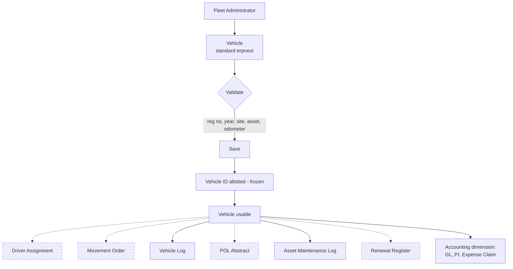

---

## B. Driver-to-Vehicle Assignment

**What is this?** A dated record of who drives which vehicle.
**Why?** So that a penalty, an accident or a fuel claim can always be traced to whoever was
driving at the time. The blueprint is explicit that history must be *preserved, not
overwritten*.
**Who?** Fleet Administrator.
**Where?** `GDL Fleet → Vehicle Master → Driver Assignment`.

### Steps

1. Open Driver Assignment, click Add. Numbered `DA-2026-00001`.
2. Choose **Vehicle** and **Driver**.
   → *Automatic:* Employee, Location and Licence No. fill in from the driver record.
3. Enter **Purpose**.
4. Choose **Assignment Type**: **Primary** (the regular driver), **Temporary** (standing in
   for a spell) or **Relief** (covering a shift or one trip).
5. Enter **From Date**. Leave **To Date** empty for open-ended.
6. **Submit.** The vehicle's assigned driver updates to match.

**On save:** driver details re-fetch, so correcting a driver's employee link fixes every
draft naming them. **On submit:** the assignment becomes active and the vehicle points at
the driver.

**The one rule:** only **one Primary** assignment may be active for a vehicle at a time.
Overlapping dates are refused, naming the clash. Temporary and Relief *may* overlap a
Primary — that is their purpose.

**Handing over:** do **not** edit the old record. Set a To Date on it and create a new one
starting the next day. Both survive, and `Driver Assignment History` shows the chain.

**How the Movement Order finds the driver:** `get_active_driver()` returns the assignment
covering that date, preferring **Temporary → Relief → Primary** — so a stand-in correctly
outranks the regular driver for the days they are covering. An authorised user may still
override it by hand.

**Validations:** From Date ≤ To Date · no overlapping active Primary · driver must exist.
**Alerts:** Driving Licence Expiry, 14 days ahead, to Fleet Manager.
**Reports:** Driver Assignment History.
**Standard vs custom:** **CUSTOM** DocType. `Driver` itself is DEFAULT (erpnext) + 4 fields.

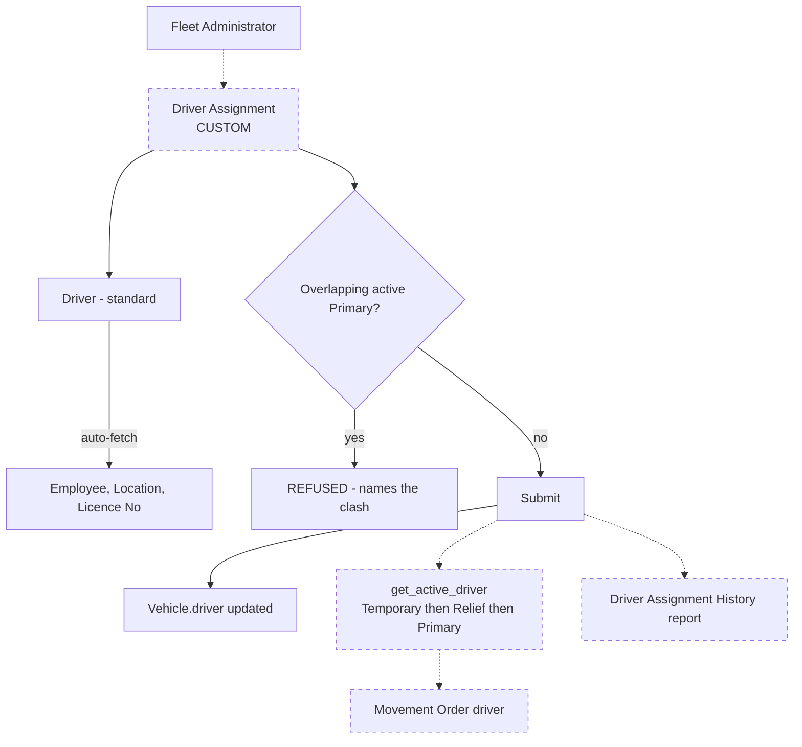

---

## C. Insurance and Renewal Management

**What is this?** Every policy and certificate a vehicle must hold, with its expiry.
**Why?** An expired policy is a vehicle that should not be on the road. GDL needs the
history, not just the current document.
**Who?** Fleet Administrator.
**Where?** `GDL Fleet → Vehicle Master → Renewal Register`.

### Steps

1. Open Renewal Register, click Add. Numbered `REN-2026-00001`.
2. **Renewal Type**: Insurance, Registration, Fitness, Emission, Permit, Road Tax, Other.
3. Vehicle, Location, **Policy / Certificate No.**
4. **Provider / Authority**, and the Supplier if the premium is paid through accounts.
5. **Premium / Fee**, **Effective From**, **Expiry Date**.
6. Attach the scanned certificate. **Submit.**

**Automatic:** `Days to Expiry` and `Renewal Status` (Valid → Due Soon → Expired, or
Renewed). Due Soon begins at the configured notice window.

**Renewing:** create a **new** record for the new period and set **Previous Renewal** to
the one it replaces. The old record is marked **Renewed** with its particulars untouched.
Never edit the old record — the blueprint requires renewal history.

### The reminder ladder — a business decision is outstanding

The blueprint states four different schedules (14 in the heading, 14 in the narrative,
**30** in the `Days Before` field, 7/3/expiry as escalation, and 30/15/7 in the reports
section). **Do not assume which is intended.** Configured today:

| Notification | Days | State |
|---|---|---|
| Renewal Due (First Reminder) | 14 before | enabled |
| Renewal Due (Second Reminder) | 3 before | enabled |
| Renewal Due (Third Reminder) | 7 before | **disabled** |
| Renewal Due (Final Reminder) | 3 before | **disabled** |
| Renewal Expired | 1 after | enabled |

Recipients are **Fleet Administrator** and **Fleet Manager** by role. Setting a rung to 0
disables it; any positive number re-enables it.

> ⚠ **On staging, outbound email is muted and the scheduler is paused.** No reminder will
> actually be delivered during testing. Verify the *configuration*, not the delivery.

**Optional automation:** a daily job can raise a Purchase Order for an expiring policy.
It is **off**, and needs `Insurance Renewal Item`, `Default Insurance Supplier` and a lead
time before it can be switched on.

**Reports:** Insurance and Renewal Due.
**Standard vs custom:** **CUSTOM** DocType; alerts are **CONFIGURATION** of standard
frappe Notifications, driven by frappe's own daily job.

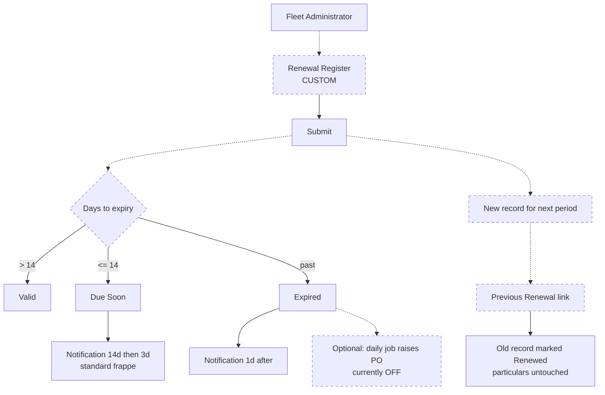

---

## D. Movement Order Request

**What is this?** An employee asking for a vehicle.
**Why?** So vehicles are allocated against a recorded need, with notice, rather than by
phone call.
**Who?** Any **Fleet User** raises it; the **location MTO** (Fleet Approver) reviews it.
**Where?** `GDL Fleet → Movement → Movement Order Request`.

### Steps — the requester

1. Open Movement Order Request, click Add. Numbered `MOR-2026-00001`.
   → *Automatic:* your name fills in as requester.
2. **Employee** — *the person travelling*, not a driver. Department fills in from it.
3. Site, Project, Task, Cost Center the trip belongs to.
4. **Purpose**, **Usage** (Business/Official/Personal/Other), **Priority** (Routine /
   Critical Business / Emergency).
5. **Passenger Count** and **Required Vehicle Type** — you ask for a *type*, not a vehicle.
6. *(Optional)* name the travellers in **Passengers / Officials**. They carry to the order.
7. Travel date and time, return date and time, **Pickup Location**, **Destination**.
8. **Submit for Review.**

> **You cannot choose your own vehicle.** `Vehicle` and `Driver` sit at permission level 1;
> a requester has read but not write. If requesters could self-allocate, checking
> availability would be meaningless.

**Lead time:** the system records `Lead Time Given`. Inside **24 hours** a
**Short-Notice Reason** is required. Marking the request **Emergency** bypasses the rule.
`Allocation Priority` is computed — lower is served first; urgency decides, notice breaks
ties.

### Steps — the location MTO

1. Open the request from **Movement Request Status** or your notifications.
2. Click **Check Availability** — lists vehicles of that type free for the window,
   excluding anything booked, Under Maintenance, Unavailable or Disposed.
3. Set **Assigned Vehicle** and **Assigned Driver**.
4. Add **Approver Remarks**, then **Accept** — or **Reject** with a reason the requester sees.

> **Only the MTO named for that site may accept**, or the **Head Office MTO**, who is the
> final authority and the cover when a site's MTO is away. Anyone else is refused by name.
> This is **one** approval, not two. An MTO who raises a request cannot accept it themselves.

**States:** Draft → Pending Review → Accepted / Rejected / Cancelled.
**Alerts:** Pending Review → Fleet Reviewer (system notification); Accepted and Rejected →
the requester.
**Reports:** Movement Request Status (with turnaround time).
**Standard vs custom:** **CUSTOM** DocType; workflow is **CONFIGURATION**; the location-MTO
rule is **CUSTOM** Python (`utils/location_officers.py`).

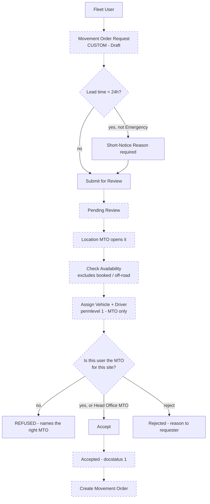

---

## E. Movement Order

**What is this?** The approved authority for a vehicle and driver to make a journey.
**Why?** Dispatch must be authorised, and double-booking must be impossible.
**Who?** The location MTO creates and approves it; Fleet Administrator dispatches.
**Where?** `GDL Fleet → Movement → Movement Order`.

### Two ways to start one — both now identical

- From the **accepted request**, click **Create Movement Order**; or
- Open a **new Movement Order** and pick the request in `Movement Order Request`.

Either way these carry across automatically:

| From the request | Becomes on the order |
|---|---|
| Assigned Vehicle, Assigned Driver | Vehicle, Driver |
| Travel date + time | Departure Date & Time |
| Return date + time | Expected Return |
| Employee (requester) | Requested By |
| Pickup Location, Destination, Purpose | From Location, Destination, Purpose |
| Department, Site, Vehicle Type | Department, Location, Vehicle Type Required |
| Passenger Count, **Passengers / Officials** | No. of Passengers, **Passengers** |
| — | Driver Assignment, Driver's Employee, Driver's Licence No. |

### Steps

1. Create from the accepted request. *Only an accepted request, and only one order per request.*
2. Check the carried values; confirm Vehicle and Driver.
3. Set Departure Date & Time and Expected Return.
4. Check the **Passengers** table — the requester's names are already there.
5. **Submit for Approval**, then **Approve**.
6. **Dispatch** when the vehicle leaves; **Complete** when it returns.

**States:** Draft → Pending Approval → Approved → Dispatched → Completed (or Rejected,
which stays *editable* so it can be corrected and **Resubmitted**; or Cancelled).

**Why one person does both submit and approve:** the decision was taken when the MTO
accepted the request. Submitting and approving the order is the same authority confirming
the dispatch they already authorised. The *decision* still cannot be self-approved — an
MTO cannot accept their own request.

**Validations:** request must be Accepted and unused · expected return after departure ·
vehicle must be available (not Under Maintenance/Unavailable/Disposed) · **no overlapping
order for the same vehicle** · both checks re-run on edit, so widening the dates cannot
slip a clash through · only the site's MTO or the Head Office MTO may approve.

**Reports:** Movement Order Register, Vehicle Availability.
**Standard vs custom:** **CUSTOM** DocType; workflow **CONFIGURATION**.

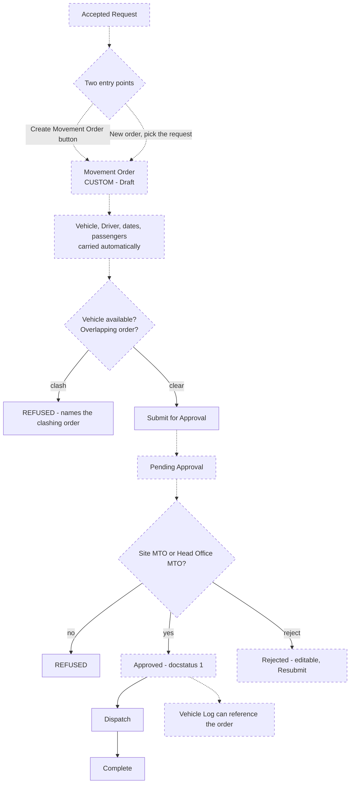

---

## F. Daily KM / Vehicle Log / Odometer

**What is this?** One record per vehicle per day of distance run.
**Why?** Every downstream figure rests on the odometer — fuel efficiency, service due
dates, tyre life, utilisation.
**Who?** Fleet Driver or Fleet Administrator.
**Where?** `GDL Fleet → Operations → Daily KM / Vehicle Log`.

> **Which DocType?** The blueprint allowed "Vehicle Log **or** a custom Daily KM Log".
> The implementation uses the **standard HRMS Vehicle Log**, extended with 19 custom fields
> and a replaced controller class. There is **no separate Daily KM Log DocType** — the
> workspace label "Daily KM / Vehicle Log" is the same record under GDL's name.

### Steps

1. Open Daily KM / Vehicle Log.
2. Choose the **Vehicle** → *Automatic:* **Opening Odometer** fills from the last reading.
3. Set the **Date**.
4. Enter the **Closing Odometer** → *Automatic:* **Distance Travelled** computes.
5. Enter **Place to Travel** (required). Add start location and destination if useful.
6. Link the **Movement Order** if the day's running was against one → driver taken from it.
7. Set Usage and dimensions. **Submit.**

**On submit:** the vehicle's **Current Odometer** moves to the closing reading.

**Validations:** one log per vehicle per day (a log tied to a movement order is treated
separately, so two distinct movements in one day can both be recorded) · closing ≥ opening,
so distance can never be negative · a reading more than **500 km** above the opening
**warns but does not block** — a long trip is legitimate.

**On cancellation — the important one:** the odometer is **recalculated from the readings
that remain**, not reduced by the cancelled distance. HRMS's own implementation subtracts,
which drags the odometer backwards past newer readings. That defect is corrected by the
`GDLVehicleLog` class override.

**Feeds:** POL performance per litre, Service Due, tyre km achieved, Vehicle Utilization.
**Standard vs custom:** DocType **DEFAULT** (hrms) + 19 fields + class override →
**CUSTOM EXTENSION**.

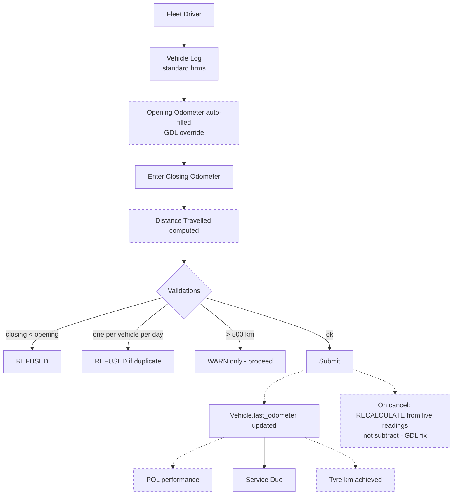

---

## G. Fuel and POL Management

**What is this?** The periodic fuel statement for one vehicle: every fill-up, what was
recouped from each coupon provider, the tank balances, the distance, and the efficiency.
**Why?** GDL buys fuel on coupons from **two providers — BOD and STCBL** — and claims
against each separately. The abstract is both the operational record and the basis of the
supplier invoice.
**Who?** The **Fleet Driver** prepares and submits it; **Fleet HR Approver** approves —
matching the blueprint's own sheet, signed *Thinley Dorji / Driver* and approved by
*Mr. Sonam Tobgye / Head-HR*.
**Where?** `GDL Fleet → Operations → POL Abstract`.

### Steps

1. Open POL Abstract, click Add. Numbered `POL-2026-00001`.
2. Choose the **Vehicle** → *Automatic:* driver from the active assignment; **Opening KM**
   and **Previous Tank Balance** suggested from the last abstract; **Opening Book Balance**
   carried from the last approved abstract.
3. Set **Period From / To** and **Distance Basis** (KM or Hours).
4. In **Entries**, add a row per fill-up: Supply Memo No., Date, **Supplier**, Litres,
   Rate, Odometer, Fuel Type, Driver.
   → *Automatic:* **Amount = Litres × Rate**. Editable — if the approved memo shows a
   different figure, type it and the row is flagged **Amount Overridden**.
   → *Automatic:* the **Supplier routes the amount.** BOD or STCBL — whichever the
   supplier is, that is the claim the money lands in. Only those two are offered, and a
   supplier that is neither is refused.
   → *Tip:* use **Set for All Rows** to apply a supplier, fuel type, rate or driver across
   the table.
5. Enter **Closing KM**, **Present Tank Balance**.
6. Enter **Total Fuel Recoupment** for BOD and for STCBL — **once, on the abstract**, not
   per row.
7. **Attach the supplier's fuel bill.** Mandatory.
8. **Submit for Approval** → HR approves.

### Every figure, and how it is worked out

```
Total Fuel Supplied   = sum of litres on every row
Amount (per row)      = Litres × Rate                      (overridable)
   → claimed from     = whichever provider the row's Supplier names
Total KM              = Closing KM − Opening KM
Total Fuel Consumed   = Total Fuel Supplied + Previous Tank Balance − Present Tank Balance
                        (both tank balances hidden and at 0, so this = Supplied)
Performance per Litre = Total KM ÷ Total Fuel CONSUMED      (not supplied)
Closing Book Balance  = Opening Book Balance + Recoupment − Amount   (BOD and STCBL separate)
```

### What is hidden — and still working

GDL asked for the provider split and the tank balances to come off the screen. None was
deleted; each still feeds a calculation.

| Hidden | Where | Still drives |
|---|---|---|
| `Amount (BOD)` · `Amount (STCBL)` | each line | the claim and the book balance — now derived from the Supplier |
| `Amount (BOD)` · `Amount (STCBL)` | the abstract | the closing book balance and the Purchase Invoice per provider |
| `Previous` · `Present Tank Balance` | the abstract | Total Fuel Consumed — both at 0, so **consumed = supplied** |

> ⚠ **The tank balances change a figure.** The blueprint's example carries 40 litres at
> the start and 60 at the end, giving 134.81 consumed from 154.81 supplied and 8.00 KM/L.
> With the fields hidden the same period computes 154.81 and 6.97. The formula is intact —
> unhiding the two fields restores it exactly.

**Why consumption is "supplied + previous − present":** fuel you had at the start, plus
fuel you bought, less what is still in the tank, is what you actually burned. Reversing the
two balances gives a plausible but wrong answer — and the blueprint's own sheet proves the
order, because 1,079 ÷ 134.81 is exactly the 8.00 printed on it.

### Verified against the blueprint, page 8 (BG-1-A2397)

| Figure | Blueprint | System |
|---|---|---|
| Total litres | 154.81 | 154.81 |
| Total amount (STCBL) | 16,339.43 | 16,339.43 |
| Total KM | 1,079 | 1,079 |
| Fuel book balance (BOD) | 15,000.00 | 15,000.00 |
| Fuel book balance (STCBL) | 3,660.57 | 3,660.57 |
| Total fuel consumed | 134.81 | 134.81 |
| Performance per litre | 8.00 | 8.00 |

### The coupon's running balance

The blueprint asks that the coupon's **"to-date amount should be maintained"**. A coupon
book is not emptied and reissued each period, so each abstract **opens where the last one
closed**:

- Only an **approved** abstract carries forward — a draft is not an agreed balance.
- Each vehicle has its **own** coupon book.
- An abstract entered **out of order** reads only periods that ended before it began.
- The opening balance is **read-only** and recomputed on every save.
- Overspending gives a **negative** balance — a real debt, not floored at zero.

### Accumulating multiple fill-ups

The blueprint notes: *"fuel details will be filled in only after multiple fill-ups, once
the recoupment amount has been reached."* That is exactly the abstract's shape — many
`POL Entry` rows accumulate over a period, and the claim is made once against the whole.

**Validations:** period from ≤ to · closing KM ≥ opening KM · supply memo unique per
vehicle · tank balances not negative · **supplier bill attachment mandatory** · mileage
deviation beyond ±10% blocks until a reason is given.

**Supplier invoice and payment:** on approval, one **Purchase Invoice per provider** for
that provider's amount only, charged to the fuel expense account **of the company that owns
the vehicle**, and linked back by `Purchase Invoice.pol_abstract`.
→ ⚠ **Blocked today:** BOD and STCBL suppliers do not exist.

**Reports:** POL Summary Register, POL Supplier and Book Balance, Fuel Consumption and
Performance, Mileage Deviation Dashboard.

### Printing

The **POL Abstract** format is the **default**, so the printer icon in the sidebar (or
`Ctrl+P`) produces it without choosing anything. It is laid out to match GDL's own paper
form — ruled outer box, logo top right, `1.00 / 2.00` numbering, `05.11.26` dates, grey
ruled value boxes, Driver / Head-HR sign-off.

Three deliberate differences from the paper original:

| | Paper form | Printout |
|---|---|---|
| Money columns | `Amount (BOD)` + `Amount (STCBL)`, one always empty | **one `Amount (Nu)`**; Total = both providers |
| Odometer unit | `km/hr` | **`km`** — a distance is not a speed |
| Performance unit | `ltrs` | **`KM/L`** — km per litre is not a volume |

The printed lines do not name the supplier, so on a mixed-provider abstract the summary
shows split totals without showing which lines produced them. The provider is on screen,
in POL Supplier / Book Balance, and on each invoice.
**Standard vs custom:** **entirely CUSTOM** — every calculation is GDL-specific.

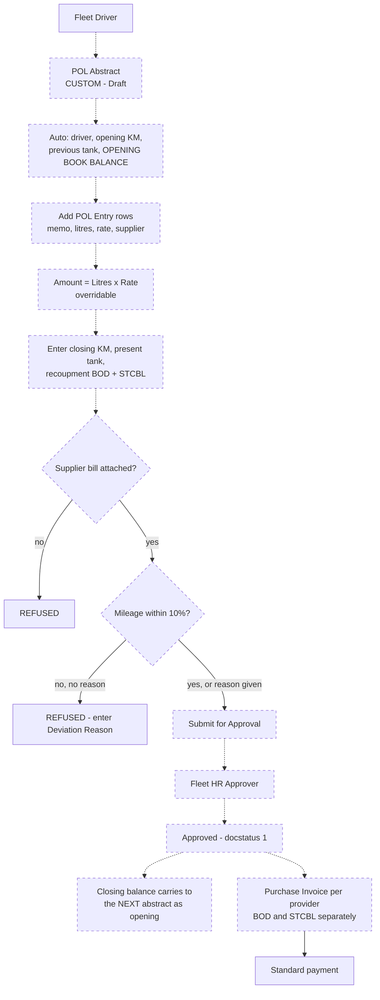

---

## H. Fleet Utilization and Mileage Monitoring

**What is this?** Comparing what each vehicle actually achieves against the target set for it.
**Why?** The blueprint sets a minimum km/litre per vehicle and asks for escalation beyond ±10%.
**Who?** Fleet Driver meets it; Fleet HR Approver reviews it; Fleet Manager reads it.

**How the ±10% rule works:**

```
deviation % = (actual KM/L − minimum KM/L) ÷ minimum KM/L × 100
below  −10%  → Below Tolerance
above  +10%  → Above Tolerance
minimum is 0 → Not Applicable        (the BYD EV — km/litre is meaningless)
```

Both ends are checked. An implausibly *good* figure usually means a missed fill or a wrong
odometer, so it is flagged too.

**What happens beyond tolerance:** the abstract **cannot be submitted** until a
**Deviation Reason** is entered. The abstract is flagged and goes to HR on the existing POL
chain. There is **no separate approval branch** — this is where the implementation differs
from the blueprint's wording *"requires HR approval workflow"*. One approval, with a flag.

**Reports:** Mileage Deviation Dashboard, Vehicle Utilization, Fuel Consumption and
Performance. **Settings:** `Mileage Deviation Tolerance` (10%), `Deviation Requires HR
Approval` (on).
**Standard vs custom:** **CUSTOM**.

---

## I. Vehicle Maintenance Management

**What is this?** Planned servicing and unplanned repairs.
**Why?** To keep vehicles roadworthy and to know what each one costs to run.
**Who?** Fleet Maintenance User records; Fleet Driver hands in the bill; Bill Approver approves.
**Where?** `GDL Fleet → Service & Maintenance`.

> **Which ERPNext module?** The blueprint names *Maintenance Schedule* and *Log Book*. The
> implementation uses **Asset Maintenance Log** and **Asset Repair** instead. ERPNext's
> Maintenance module is for servicing equipment sold to a **customer** — `Maintenance Visit`
> makes `customer` mandatory — so using it would force a Customer record and a sales item
> per GDL vehicle. "Log Book" is not an ERPNext DocType at all.

### The simplest working flow for GDL

| Use | When | Prerequisite |
|---|---|---|
| **Asset Maintenance Log** | Any planned service | **None** — one form, nothing to set up first |
| **Asset Repair** | Breakdown or accident | The vehicle must be a fixed **Asset** record |
| **Asset Maintenance** | A preventive plan with scheduled tasks | A Maintenance Team |

Only 3 Assets exist for 14 vehicles, so **Asset Repair is not usable fleet-wide today**.
Until every vehicle is registered as an Asset, record breakdowns on the maintenance log
with category **Corrective**. That keeps one form for everything, which is what GDL asked for.

### Recording a service

> **Changed November 2026 (DEF-001).** Cost and bill fields now sit at a higher
> permission level than a driver holds, so the person who took the vehicle in is no longer
> the person who records what it cost. The driver records the visit; the Maintenance User
> records the money.

**The driver** — permission level 0:

1. Open **Asset Maintenance Log**.
2. Vehicle, Location, **Service Date**, **Odometer** at service.
3. **Driver** who took it in → *Automatic:* their employee record.
4. In **Maintenance Items**, a row per job — item, quantity, part/brand.
   *The **Cost** column is greyed out — it is above a driver's level.*
5. Save, and hand over the paper bill.

**The Maintenance User or Administrator** — permission level 1:

6. Enter **Service Provider**, **Bill No.**, **Bill Date**, **Bill Attachment**.
7. Enter **Parts Cost**, **Labour Cost** and the per-item costs.
   → *Automatic:* total cost.
8. *Automatic:* **Next Service Date** and **Next Service KM** from the maintenance rules.
9. **Submit**, then **Submit Bill**.

### The maintenance rules

Twelve seeded; **whichever falls first** — kilometres or months — makes the service due.

| Item | Every | Or every |
|---|---|---|
| Engine Oil, Engine Oil Filter | 7,500 km | 6 months |
| Fuel Filter, Air Filter | 10,000 km | 12 months |
| Tyre Replacement / Rotation | 20,000 km | 24 months |
| Brake Pads | 30,000 km | 24 months |
| Brake Fluid, Gear Oil, Coolant | 40,000 km | 24 months |
| Battery Replacement | — | 36 months |
| General Inspection | — | 6 months |
| Other Repair or Maintenance | — | — |

All six intervals in the blueprint's chart are present; the other six were added to cover
the service types the blueprint lists in §4.11.

### The service bill → payment cycle

```
Driver submits bill → Bill Approver approves → Purchase Invoice raised
→ Accounts pay → Payment Status reads back → Payment Processed
```

**Who may do what, by permission level:**

| Level | Fields | Who may write |
|---|---|---|
| **0** | Vehicle, odometer, service date, maintenance items (item, qty, brand), driver, actions performed | Fleet Driver, Fleet Maintenance User, Fleet Administrator |
| **1** | Service provider, parts cost, labour cost, total, bill no./date/attachment, cost centre, project, **and the Cost column inside Maintenance Items** | Fleet Maintenance User, Fleet Administrator |
| **2** | Bill status, submitted by, approved by, purchase order, purchase invoice, payment status | Fleet Administrator only — the rest is written by the system |

**Five things before a bill can go up:** service centre, bill no., bill date, a total above
zero, and the **bill attachment**. The same bill number against the same supplier is
refused anywhere in the purchase ledger — the guard against a workshop billing twice.

> ⚠ **Blocked today:** `Bill Approver Role` is blank, so **nobody at all** can approve a
> bill. `Purchasing Company` and `Maintenance Service Item` are also blank, so no purchasing
> document can be raised. The record always says *why* in `Purchasing Note` rather than
> failing silently.

**Reports:** Service Due, Service History, Cost by Vehicle.
**Standard vs custom:** DocTypes **DEFAULT** (erpnext Assets) + 47 custom fields + doc_events
→ **CUSTOM EXTENSION**. The whole bill and purchasing cycle is custom.

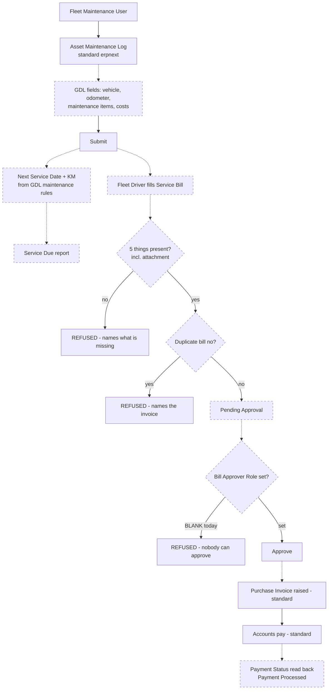

---

## J. Spare Parts and Tyre Lifecycle

**What is this?** Issuing parts and tyres from store to a vehicle, and following a tyre
from fitting to removal.
**Why?** To know what each vehicle consumes, to trace serialised parts, and to judge
whether tyres reach the 20,000 km target.
**Who?** Fleet Store User.
**Where?** `GDL Fleet → Parts & Tyres`.

### Issuing

1. Open **Fleet Part Issue**. Numbered `FPI-2026-00001`.
2. Vehicle, Issue Date, Odometer, Purpose, **Source Warehouse**.
3. Add items — item code, quantity, rate; tick **Is Tyre** and set **Position** for a tyre.
4. **Submit.**

**On submit — automatic:**
- A standard **Stock Entry (Material Issue)** is raised and linked. *The fleet module never
  holds quantities of its own, so it cannot drift from the stock ledger.*
- A **Vehicle Tyre** record is created for each tyre row, status **Fitted**, carrying the
  fitted date, odometer and **its cost from the issue row**.

**Validations:** at least one item · quantity > 0 · **a tyre is one per row** (so each can
be tracked to the kilometres it achieves) · a tyre needs a position · a serialised item
needs a serial number · the same serial cannot appear twice · a tyre already recorded as
fitted cannot be fitted again.

**On cancel:** the Stock Entry is cancelled and the tyre records removed.

### A tyre's life

Set **Removed Date** and **Removed Odometer** → *Automatic:* `KM Achieved` = removed −
fitted, and performance classified against **20,000 km ±20%** (the 16,000–24,000 band):
Below / Within / Above Tolerance. A tyre far *above* the band usually means a missed
removal reading, so it is flagged too.

**Reports:** Parts Consumption, Part Replacement History, Tyre Mileage Report, Tyre Cost
Analysis. **Cost per km** is the figure that fairly compares a cheap tyre lasting 12,000 km
against an expensive one lasting 30,000.

**Expense Claim:** a link field exists on Fleet Part Issue, but there is **no automation and
no records** — the blueprint's "integrated with Stock Entry & Expense Claim" is half met.

> ⚠ **Unverifiable today:** 0 part issues, 0 tyres, 0 stock entries on staging.

**Standard vs custom:** `Fleet Part Issue` and `Vehicle Tyre` are **CUSTOM**; Stock Entry,
Item and Serial No are **DEFAULT**.

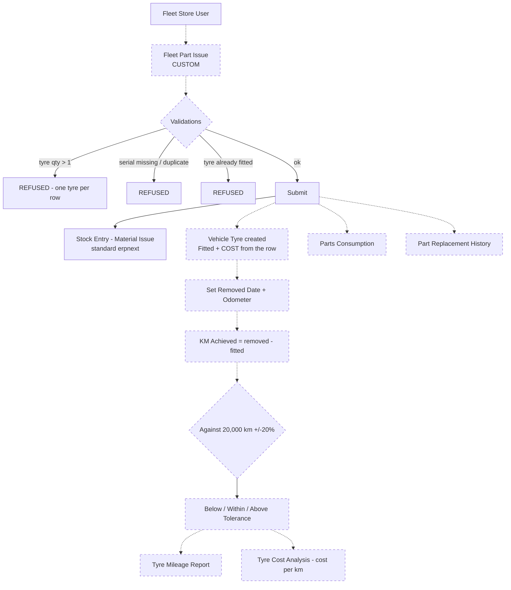

---

## K. Vehicle Expenses and Accounting

**What is this?** Getting fleet cost into the general ledger, attributable to the vehicle.
**Why?** So fleet cost and company accounts cannot diverge.

**The mechanism:** **Vehicle is registered as an ERPNext Accounting Dimension.** A
`vehicle` field therefore exists on GL Entry, Purchase Invoice, Expense Claim, Stock Entry,
Journal Entry and every other dimension-bearing DocType.

| Expense | Route | Standard or custom |
|---|---|---|
| Fuel | POL Abstract → Purchase Invoice per provider | Custom trigger, **standard** invoice |
| Maintenance | Service bill approval → Purchase Invoice | Custom trigger, **standard** invoice |
| Insurance | Renewal Register → optional Purchase Order (off) | Custom trigger, **standard** PO |
| Spare parts | Fleet Part Issue → Stock Entry | Custom trigger, **standard** stock move |
| Any other | Expense Claim / Journal Entry with the vehicle dimension | **Standard** |

**Cost Centre and Project** flow from the vehicle, or are set per transaction, and carry to
the purchasing document.

**Reports:** Cost by Vehicle (expense claims, purchase invoices, stock issues, repairs,
journals, with cost per km) — plus the **standard** General Ledger, Budget Variance and
Profitability Analysis, all filterable by vehicle.

**Standard vs custom:** the accounting itself is **entirely standard**. What is custom is
the *trigger* and the dimension **CONFIGURATION**. No parallel fleet ledger exists, which
is exactly right.

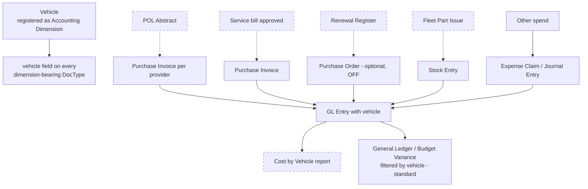

---

## L. Reports and Dashboards

**Where:** `GDL Fleet → Reports`, or the dashboard at the top of the workspace.

### The dashboard — five figures that answer "is anything wrong today?"

| Figure | Counts | If not zero |
|---|---|---|
| Vehicles Active | Vehicles on the road | Should equal your whole fleet |
| Off Road | Under Maintenance or Unavailable | Open Service Due |
| Renewals Due | Due Soon or Expired | Open Insurance / Renewal Due |
| Requests Awaiting a Manager | Requests at Pending Review | An MTO has not acted |
| Mileage Outside Tolerance | Abstracts beyond ±10% | Open Mileage Deviation Dashboard |

Five charts below: Fleet by Site, Fleet by Status, Distance Travelled (monthly), Fuel Spend
(monthly), Movement Orders (weekly). All read live off the records.

### The eighteen reports

| Report | Data from | Answers |
|---|---|---|
| Fleet Register | Vehicle | What do we own? |
| Vehicle Utilization | Vehicle Log | Which vehicles earn their keep? |
| Vehicle Availability | Vehicle + Movement Order | What is free right now? |
| Driver Assignment History | Driver Assignment | Who was driving? |
| Service History | Asset Repair + Asset Maintenance Log | What has been done? |
| Service Due | Asset Maintenance | What needs servicing? |
| Insurance and Renewal Due | Renewal Register | What expires soon? |
| Movement Request Status | Movement Order Request | Pending / accepted / rejected + turnaround |
| Movement Order Register | Movement Order | Approved movements by vehicle, driver, period |
| Cost by Vehicle | GL + invoices + stock + repairs | What does each vehicle cost per km? |
| POL Summary Register | POL Abstract | Every abstract with totals and status |
| POL Supplier and Book Balance | POL Abstract + POL Entry | Opening → Recoupment → Closing per provider |
| Fuel Consumption and Performance | POL Abstract | KM, fuel, KM/L by vehicle and period |
| Mileage Deviation Dashboard | POL Abstract | Who is outside ±10% |
| Tyre Mileage Report | Vehicle Tyre | KM achieved against 20,000 ±20%, with cost/km |
| Tyre Cost Analysis | Vehicle Tyre | Tyre spend and cost per km by vehicle/item/site |
| Parts Consumption | Fleet Part Issue | What left store, and what it cost |
| Part Replacement History | Fleet Part Issue | How long each part lasted |

All are **CUSTOM** Script Reports with filters, role-restricted, reading live documents.

> **Regression note:** Cost by Vehicle, Fuel Consumption and Performance, Service Due and
> Service History had their filter definitions registered under the wrong report name and
> **showed no filters at all** until 3 November 2026. Re-check after any change.

---

## M. How the processes connect

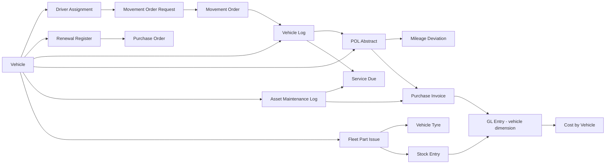

**The spine:** the vehicle holds identity; the assignment says who drives it; the request
and order authorise a journey; the log records the distance; the abstract turns distance
and fuel into efficiency and a supplier claim; maintenance and parts keep it running; and
every money movement lands in the general ledger against the vehicle.

---

## N. What is still missing before users can work

| Missing | Blocks | Who supplies |
|---|---|---|
| Drivers (1 record), Employees (1) | Assignments, movement orders, POL, part issues | GDL |
| BOD and STCBL suppliers | **Every fuel claim** | GDL |
| `Bill Approver Role` | **Every service bill** | GDL decision |
| `Purchasing Company`, `Maintenance Service Item` | Purchasing documents | GDL decision |
| `Default Maintenance Team` | Preventive plans | GDL |
| Stock items and opening stock | Parts and tyres | GDL stores |
| Role assignment — 5 roles held by nobody | Those processes have no operator | GDL |
| Passwords for 14 fleet users | Testing as a real user | Administrator |
| Chassis/engine numbers, acquisition dates, odometers | Completeness | GDL |
